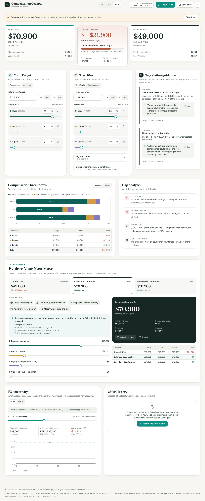
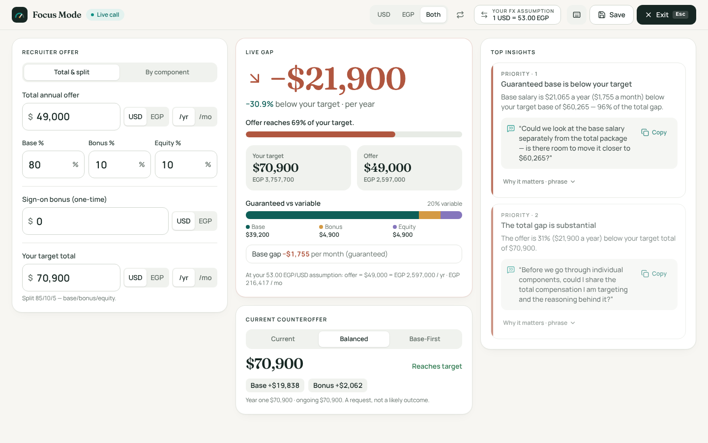
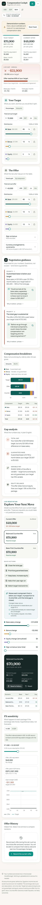

# Compensation Cockpit

**Negotiate with clarity.**

Compensation Cockpit is a real-time, browser-only workspace for candidates negotiating job offers. The primary scenario is a candidate in Egypt negotiating with an international company, where the offer may be in USD, the cost of living and taxes are in EGP, and the exchange rate moves. You enter your target package and the offer you received, then see the gap, the breakdown, what each currency arrangement is worth, and which counteroffers would close the gap. Every number updates as you type. Its signature feature is **Focus Mode**, a reduced, enlarged layout meant to be used live on a recruiter call, with the key figures large and readable and the controls within reach. There is no backend and no accounts. Your data is stored only in the browser's `localStorage`.

## Screenshots







## Features

**Target package**
- Express the target as percentages (base / bonus / equity) or as amounts. Percentages are linked and can be locked, so changing one redistributes the others.
- Enter the total and split it, or enter each component directly.

**Offer**
- Offer by total and split, or by component.
- Bonus as a percentage of base or as a fixed amount, with an estimated payout (percent of target) and an optional guaranteed first-year payout.
- Equity in simple mode (annualized value) or advanced mode: grant value, vesting years, annual / quarterly / custom schedule, a cliff in months, an assumed annual share-price change, and optional refresh grants (off unless you opt in).
- Sign-on bonus paid in year one or split across two years, with an optional repayment (clawback) period.
- Choose how USD amounts are paid: in USD, or USD-linked and paid in EGP (see [Financial rules](#financial-rules)).

**Analysis**
- Display in USD, EGP, or both, with a switch for which currency is emphasized.
- User-provided exchange rate, default 53 EGP per USD. This is an assumption you can edit. The app never fetches a live rate.
- Hero comparison of target versus offer.
- Breakdown chart and table by component.
- Gap analysis per component and in total.
- FX sensitivity: how the offer's value in each currency changes as the rate moves.

**Scenarios**
- Counteroffer scenarios you can edit with sliders, compared side by side against the target.
- Quick actions: close the gap, base-first, equity-only, sign-on, and match the target with a mix.

**Guidance**
- Deterministic, rule-based negotiation guidance computed from your own numbers. Each insight explains what it means, why it matters, a question to ask, and an optional phrase to use. The wording is evidence-aware: it makes no claims about employer policy or salary bands and does not call the offer fair or unfair.

**History and data**
- Save offers to a history, with timeline and comparison of any two.
- JSON import and export, with schema validation. Malformed or newer-version files are rejected with a message rather than applied.
- Printable one-page summary.

## Focus Mode

Press **F** (or the Focus Mode button) during a recruiter call. The screen reduces to the recruiter's offer inputs (enlarged), your target, the live gap and how much of the target the offer reaches, guaranteed versus variable pay, the FX conversion, the top two negotiation questions with copy buttons, and the current counteroffer. Advanced equity modelling is hidden. At 1440×900 everything fits without scrolling.

| Key | Action |
| --- | --- |
| `F` / `Esc` | Enter / leave Focus Mode |
| `U` · `E` · `B` | Display USD · EGP · Both |
| `X` | Swap the emphasized currency |
| `1` · `2` · `3` | Select a scenario |
| `S` | Save the offer to history |
| `?` | Show shortcuts |

Shortcuts are ignored while typing in a field.

## Quick start

Requirements: Node.js 20 or newer (tested on Node 22) and npm.

```bash
cd compensation-cockpit
npm install
npm run dev        # development server with hot reload
```

To produce and check a production build:

```bash
npm run build      # type-checks, then builds into dist/
npm run preview    # serves dist/ over HTTP at http://localhost:4173
```

Serve `dist/` over HTTP. Opening `dist/index.html` directly from the file system is not equivalent to serving it and may not behave correctly.

## Scripts

| Script | Command | Purpose |
| --- | --- | --- |
| `dev` | `vite` | Start the Vite development server. |
| `build` | `tsc -b && vite build` | Type-check and produce the production build in `dist/`. |
| `preview` | `vite preview --port 4173 --strictPort` | Serve `dist/` at http://localhost:4173. |
| `typecheck` | `tsc -b --noEmit` | Type-check without emitting files. |
| `lint` | `eslint .` | Run ESLint. |
| `test` | `vitest run` | Run the Vitest unit tests once. |
| `test:e2e` | `playwright test` | Run the Playwright end-to-end tests. |
| `test:visual` | `playwright test --project=visual` | Run the Playwright visual tests. |
| `check` | typecheck, lint, test, build, test:e2e | Full gate, run in sequence. |

## Testing

**Unit tests (Vitest).** Unit tests live beside their sources as `src/**/*.test.ts` and cover calculations (`src/calc/`), guidance (`src/guidance/`), persistence (`src/state/persistence.test.ts`) and the store (`src/state/store.test.ts`). Run them with `npm test`.

**End-to-end, responsive and visual tests (Playwright).** These live in `tests/e2e`. Playwright's `webServer` builds the app and serves `dist/` with `vite preview`, so tests always run against the production build. Install the browser once, unless it is already present:

```bash
npx playwright install chromium
npm run test:e2e        # all projects: interactions + visual
npm run test:visual     # responsive/visual only
```

- `interactions.spec.ts` covers editing target and offer, percentage and amount modes, USD/EGP/Both display, FX changes (including fixed-EGP offers), Focus Mode, scenarios and quick actions, offer history persistence and comparison, JSON import/export, reset and start fresh, copy-to-clipboard, and NaN/Infinity guards.
- `visual.spec.ts` renders the dashboard and Focus Mode at 320, 375, 430, 768, 1024, 1440 and 1920 px. It fails on horizontal page overflow, offscreen elements, clipped amounts or tap targets under 24 px, compares against committed screenshot baselines, and writes reference images to `docs/screenshots/`. Refresh baselines after intentional UI changes with `npx playwright test --update-snapshots`.

## Architecture

The code is organized in layers. Dependencies point downward: UI depends on state and calculations, and calculations depend on nothing UI-related.

- **`domain/`**: zod schemas and TypeScript types for the app state, plus factories for demo data. The state is versioned (`SCHEMA_VERSION`). Every `Money` value carries its own currency and period, and that currency is the value's anchor: a USD amount stays constant in USD when the rate moves.
- **`calc/`**: pure, UI-independent financial functions built on `decimal.js`. There is one canonical conversion function, `convert` in `calc/money.ts`, and all currency conversion goes through it. Rounding is display-only and happens in `lib/format.ts`, never inside calculations.
- **`guidance/`**: deterministic rules that turn calculation results into prioritized insights. Rules read only the user's numbers.
- **`state/`**: a zustand store and versioned `localStorage` persistence. Persistence applies migrations from older versions and recovers gracefully from malformed data rather than crashing.
- **`features/`**: UI sections, one folder per area (package editors, hero, breakdown, gaps, scenarios, guidance, FX, history, print, Focus Mode, header, import/export).
- **`components/`**: shared UI pieces. `components/ui/` holds shadcn-style primitives built on `radix-ui`, written by hand (see [Known limitations](#known-limitations)).
- **`lib/`**: formatting, hooks (for example `useMoney`, `useDerived`), clipboard and class-name helpers.

```
compensation-cockpit/
├── index.html
├── vite.config.ts
├── public/                 static assets (favicon)
├── src/
│   ├── App.tsx, main.tsx, index.css
│   ├── domain/             zod schemas, versioned app data, factories
│   ├── calc/               money, bonus, equity, package, distribution, fx, scenarios
│   ├── guidance/           rule-based insights and gap analysis
│   ├── state/              zustand store, localStorage persistence
│   ├── features/           UI sections
│   ├── components/         shared components and ui/ primitives
│   ├── lib/                formatting, hooks, helpers
│   └── test/               Vitest setup
└── tests/e2e/              Playwright end-to-end, responsive and visual tests
```

## Financial rules

- **Gap** = (offer − target) / target × 100. It is undefined when the target is zero, so no percentage is computed in that case.
- **Components are never negative.** Negative inputs are clamped to zero.
- **Target bonus is not guaranteed.** The expected payout is an estimate (percent of target). Only a bonus marked as guaranteed in the first year counts as certain.
- **RSUs are not monthly cash.** A multi-year grant is annualized over its vesting period, so $20,000 over 4 years is $5,000 per year.
- **Grant value is not value at vesting.** Projections apply the assumed annual share-price change; the grant value is what was promised.
- **Sign-on is not recurring.** It is shown as a first-year item and is excluded from the recurring total.
- **Gross amounts only.** No Egyptian or other tax is modelled.

**Currency arrangements.** The offer's USD and EGP amounts are treated differently:

- **USD-denominated pay**: paid in USD. Its EGP value changes with the exchange rate.
- **Fixed EGP pay**: contractually fixed in EGP and shown as a USD equivalent. Its USD value changes with the exchange rate.
- **USD-linked pay paid in EGP**: a USD reference that is paid in EGP at the prevailing rate.

Example at 53 EGP per USD: $5,000 = 265,000 EGP. If the salary is fixed at 265,000 EGP and the rate moves to 60 EGP per USD, it is worth about $4,416.67. If the same salary had been USD-denominated, it would instead be paid as 300,000 EGP at 60.

## Deployment

The build uses `base: './'` in `vite.config.ts`, so asset URLs are relative and `dist/` works from a domain root or from a subdirectory. To use absolute paths instead, build with a base path:

```bash
BASE_PATH=/repo/ npm run build
```

**GitHub Pages.** Build, then publish `dist/` with `actions/upload-pages-artifact` and `actions/deploy-pages` in a workflow that runs `npm ci && npm run build` in `compensation-cockpit/` and uploads `compensation-cockpit/dist`. Any other static host works the same way: upload the contents of `dist/`.

**Netlify.**
- Base directory: `compensation-cockpit`
- Build command: `npm run build`
- Publish directory: `dist`

**Cloudflare Pages.** Use the same settings: root directory `compensation-cockpit`, build command `npm run build`, output directory `dist`.

The app works offline once loaded. Fonts (Fraunces and Manrope) are self-hosted through `@fontsource`, the app makes no runtime network requests, and a small service worker (`public/sw.js`, production builds only) caches the app shell so it reopens without a connection.

## Privacy

No data leaves the browser. There is no backend, no account system, and no analytics. Offers, targets, scenarios and history are stored in the browser's `localStorage` under a single key and are never sent anywhere. Clearing site data removes them. Export a JSON file if you want a copy.

## Known limitations

- The shadcn/ui CLI registry (ui.shadcn.com) and motion.dev were not reachable from the build environment's network policy. The shadcn-style components were therefore written by hand on `radix-ui` primitives, following the shadcn pattern.
- The Motion AI skill (`npx motion-ai`) could not be installed. Motion is used directly through `motion/react`.
- Data is stored per browser. It does not sync between devices or browsers.
- Exchange rates are user-supplied assumptions, not market data.

## Disclaimer

Compensation Cockpit is an informational tool. It is not financial, legal or tax advice. Scenarios model requests and their arithmetic; they do not predict likely outcomes of a negotiation or of any employer decision.
